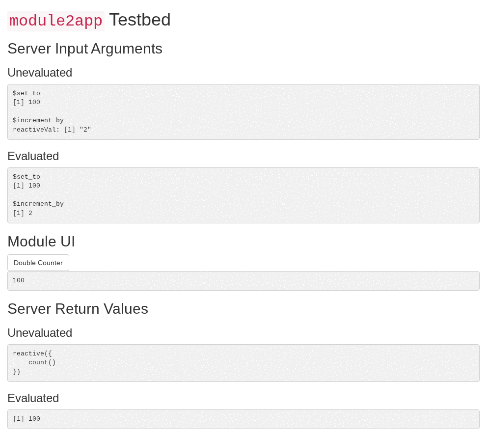

# crow

## Overview

crow is a loose collection of helpers for your shiny development.

It can help with:

- 📦 modules
- 🧪 testing
- 📖 documentation
- ... and more

crow is **opinionated on quality** ...

- Shiny apps and their modules should be proper, exported *functions in an R package*.
- *No code generation*.
  If you feel like you need to programmatically create code, you're doing it wrong.
  (I'm not talking LLMs here, but bloated boilerplates).

... but also **flexible in implementation** ...

- *No framework*.
  You use crow, crow doesn't use you.
  (It's not like [])

... and **lightweight** ...

- *~~`Imports: crow`~~*.
  crow is a time- and line-saver during development, but doesn't want to be your dependency.
  Shiny is enough.

In all of these ways, crow is also a (tiny) opposite to [rhino](https://appsilon.github.io/rhino/), [golem](https://thinkr-open.github.io/golem/) or [leprechaun](https://leprechaun.opifex.org/).

For example, `module2app()` shows a module in a full app,
with the module's input arguments, UI and return values:



## Installation

```r
# install.packages("pak")
pak::pak("dataheld/crow")
```

crow is a *development*-time dependency; it should not be in your `DESCRIPTION`s `Imports:`.

If you want to use it in your tests, you will have to include it in `Suggests:`.

If you don't need it for tests,
but want to otherwise record that you used it for development,
consider an [extra dependency](https://pak.r-lib.org/reference/package-dependency-types.html#extra-dependencies):

```DESCRIPTION
Config/Needs/website: dataheld/crow
```

## Coding agents

crow ships an [Agent Plugin](https://agent-plugins.org) in its installed package directory.
Its `add-shiny-module` skill teaches agents to build, test and document modules with crow.
Install the plugin from there,
for example in Copilot CLI:

```sh
copilot plugin install "$(Rscript -e 'cat(system.file(package = "crow"))')"
```

The plugin must match the installed crow version:
reinstall it after you upgrade crow.

The plugin's MCP server lets agents run a module of your package
without crow's displays for humans,
set its inputs, read its arguments, return values, reactlog events and logs,
and screenshot it
(see `?crow_tools`).
It needs Chrome.
The server runs R code that the agent writes, with your rights;
only a sandbox around the agent isolates your system from that code.
To serve crow's tools together with [btw](https://posit-dev.github.io/btw/)'s,
configure this server in your project instead:

```sh
Rscript -e 'mcptools::mcp_server(c(btw::btw_tools(c("docs", "pkg")), crow::crow_tools()), session_tools = FALSE)'
```
